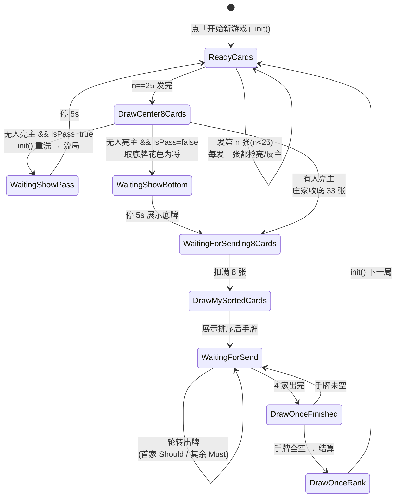

# smallnest/Tractor 对标分析（流程与规则逐项对比）

> 生成日期：2026-10-23
> 规则基准：`reference/smallnest-Tractor`（用户已拍板：「smallnest 我玩了几天了，他的规则可信，甚至比原版还好」）
> 原版二进制逆向结论（`docs/rules/游戏规则规格书.md`）降级为佐证。
> 方法：逐函数读源码，每条结论标 `文件:行号`。**不做任何业务代码改动，纯只读分析。**
> 编码说明：`DefinedConstant.cs` / `GameConfig.cs` 等为 GBK，中文注释在 UTF-8 下是乱码，属正常；代码本身可读。
>
> **v1.3.1 修订**：§0 的 #4/#5、§3.2 的拖拉机长度与多对子两行、§3.3 的「结构不符不能赢」一行，
> 已按代码现状更正 —— 其中 2 行**原记录过期**（多对子甩牌校验 v1.1 就已生效、手牌排序 v1.3.0 起有意偏离），
> 2 行**已修复/已定稿**（拖拉机长度 → ADR-016；结构判定 → v1.3.1 补 runLen）。
>
> **v1.3.3 修订**：§3.1 的「发牌张数」「发牌动画」「定庄（第一局）」「轮庄（后续局）」「亮主时机」
> 五行按代码现状更正 —— 后四行标 ❌/P0 的功能均已在 v1.2.0 落地（逐张发牌 + 飞牌、抢庄、轮庄修正、
> 发牌过程中抢亮），「发牌张数」一行则因 v1.3.3 发牌结构重写而更新为「108 张全派」。

---

## 0. 一页结论：最关键的 5 条不一致

| # | 规则项 | smallnest | 我们 | 优先级 |
|---|---|---|---|---|
| 1 | **轮庄** | 庄家方赢 → 庄家**对家**坐庄；闲家上台 → 庄家**下家**坐庄（`TractorRules.cs:548-598`） | `settle.ts:153-156` 算出了 `newDealer`，但 `game.ts:114` 每局又 `rng.int(4)` **重新随机**，`newDealer` 被丢弃 | **P0** |
| 2 | **亮主机制** | **发牌过程中抢亮**：每发一张就检查，持级牌即可亮，AI 会主动抢（`DrawingFormHelper.cs:38-97`、`Algorithm.cs:18-94`） | 发完牌弹面板，5 个花色按钮**全部可点**（不校验持牌，`render.ts:205`）；AI 从不亮主 | **P0** |
| 3 | **反主门槛** | 必须持**一对**新花色级牌（`Algorithm.cs:185` `Clubs[rank] > 1`） | 持**一张**即可（`counter.ts:50`） | **P0** |
| 4 | **拖拉机长度** | 只认 **2 连对（4 张）**；3 连对及更长按**甩牌**校验（`CurrentPoker.cs:1949-2038`、`TractorRules.cs:1000`） | 任意多连对都当纯牌型（`analyze.ts:110-126`） | ✅ 已定稿：**ADR-016** 保留为增强 —— 原版与通行规则均允许任意长度，smallnest 上限是 `GetTractor()` 的实现限制 |
| 5 | **跟牌/压牌结构** | 首出是拖拉机 → 有拖拉机**必须跟拖拉机**（`TractorRules.cs:130-148`）；结构不符不能赢（`TractorRules.cs:815-848`） | 不要求跟连对（ADR-007，**有意宽松**）；结构不符不能赢已补齐（v1.3.1 `canBeat` 比 `runLen`，散对不能压连对） | 残留仅「必须跟拖拉机」一条，按 ADR-007 保留 |

> 另有 6 条次要但明确的差异：必打默认值不同（5/10/K/A/王 vs J/A/王）、无将亮主（王对）未实现、加固未实现、AI 甩牌不校验、发牌无逐张动画、2 为常主默认值。见 §3。

---

## 1. smallnest 的游戏流程

### 1.1 状态机总览

### 1.2 逐步说明

| 步骤 | smallnest 实际行为 | 源码 |
|---|---|---|
| 洗牌发牌 | 108 张**全部**随机分配到 4 家各 27 张。**无「禁天然连对」**（纯 `Random`，无二次校验） | `Helpers/DistributePokerHelper.cs:30-52` |
| 发牌动画 | 25 个 tick，每 tick 给 4 家各发 1 张（`currentCount < 25`），带飞牌动画 | `MainForm.cs:709-713`；`Helpers/DrawingFormHelper.cs:38-97` |
| 底牌来源 | 每家列表的 **index 25/26 两张**（即发了 25 张后剩下的）共 8 张 = 底牌 | `Helpers/DrawingFormHelper.cs:47-50`（只发 `[0..24]`）+ `240-254`（`list[i][25]/[26]`） |
| 亮主时机 | **发牌过程中逐张检查**：`ReadyCards` 每发一张就调 `DoRankOrNot`（AI）/ `MyRankOrNot`（人类按钮三态） | `Helpers/DrawingFormHelper.cs:56-92` |
| 亮主条件 | 持**任意一张**当前级牌即可；4 门按钮用 `else-if` 链，优先级 **♣ > ♦ > ♠ > ♥**（只会点亮一个） | `Algorithm.cs:149-178` |
| 定庄 | **只有第一局**（`currentRank==0 && isNew`）由「第一个亮主的人」定庄；之后由轮庄规则决定 | `DrawingFormHelper.cs:583-586`、`MainForm.cs:264` |
| 反主 | 亮主后 `showSuits=1`，此时持**一对**别门级牌可反；反一次后 `showSuits=2`，**不能再反** | `Algorithm.cs:180-207`、`DrawingFormHelper.cs:641` |
| 亮无将 | 持**一对小王或一对大王**，且 `showSuits < 3` → 亮/反为无将（Suit=5） | `Algorithm.cs:209-217` |
| 无人亮主 | `DoRankNot()` 判 `Suit==0`。`IsPass=true`（默认）→ **流局重洗**；`IsPass=false` → 取底牌某张的花色为将 | `DrawingFormHelper.cs:725-736`、`MainForm.cs:738-786` |
| 埋底 | **有**。庄家收 8 张底 → 33 张 → 必须选 8 张扣回底（`readyCards.Count == 8` 才生效） | `DrawingFormHelper.cs:203-238`、`MainForm.cs:481-490`、`MainForm.cs:799` |
| 首家 | **庄家首出**（`whoseOrder = Master; firstSend = Master`） | `MainForm.cs:790-791` |
| 出牌 | 首家 `ShouldSendedCards`（自由出），其余 `MustSendedCards`（强制跟）；顺序 1→4→2→3 | `MainForm.cs:859-903`、`CommonMethods.cs:155-184` |
| 一墩计分 | **只有闲家（非庄家队）赢的墩才累计分数**；庄家队赢的墩记 0 分 | `Helpers/DrawingFormHelper.cs:2099-2114` |
| 结算 | 手牌全空 → 扣底（若最后一墩闲家赢）→ 升级 → 轮庄 → 展示 8 张底牌与总分 | `Helpers/DrawingFormHelper.cs:1925-1931`、`2229-2249`、`TractorRules.cs:601-695` |

> **注意 `WaitingForSending8Cards` 就是埋底**（不是「发 8 张」）：`switch(Master)` 里对 AI 庄家调 `Algorithm.Send8Cards(...)` 自动扣 8 张；人类庄家则等鼠标点「小猪」确认。

---

## 2. smallnest 的规则清单

### 2.1 牌与牌力

| 项 | 内容 | 源码 |
|---|---|---|
| 编码 | 0-12 ♥、13-25 ♠、26-38 ♦、39-51 ♣、52 小王、53 大王 | `CommonMethods.cs:24-28` |
| 主牌定义 | 王(52/53) + **四门全部级牌** + 主花色全部牌。**没有「2 为常主」** | `CommonMethods.cs:193-249`、`323-341`、`CurrentPoker.cs:1188-1263` |
| 牌力顺序 | 大王 > 小王 > 主级牌(主花色级牌) > 副级牌(三门外级牌，并列) > 主花色普通牌 | `CommonMethods.cs:472-611` |
| 主牌数 | `MasterRank`(主级牌) + `SubRank`(副级牌) + 双王 + 主花色非级牌 | `CurrentPoker.cs:1163-1186` |
| 打王级 | `rank == 53`：级牌不提升（`a%13==53` 永不成立），且**全员不能亮主** | `CurrentPoker.cs:1204`、`DrawingFormHelper.cs:567-568` |
| 无将(Suit=5) | `Sort()` 用 ♥♠♦♣ 顺序；`masterRank` 恒 0（`if Suit>0 && Suit<5` 才加） | `CurrentPoker.cs:1422-1425`、`1254-1261` |

### 2.2 牌型

| 项 | 内容 | 源码 |
|---|---|---|
| 单张 | 1 张 | `TractorRules.cs:992-995` |
| 对子 | 同牌值 2 张；`GetPairs()` 按 **i 升序、♥♠♦♣、双王在后** 返回（`[0]` 是**最小**对） | `CurrentPoker.cs:1574-1609` |
| 拖拉机 | **仅 2 连对**。`GetTractor()` 返回「最大那张牌的编号」，识别顺序：双王对 → 小王对+主级牌对 → 主级牌对+副级牌对 → 副级牌对+主花色A对 → 同花色相邻两对 | `CurrentPoker.cs:1949-2038` |
| 3 连对 | `GetTractor()` 只返回相邻两对的最大者 ⇒ **3 连对不被当作一种牌型**，走甩牌分支 | `TractorRules.cs:1000`、`1004-1127` |
| 混花色 | `IsMixed()`：按 `SortCards` 分段统计跨槽数 > 1 | `CurrentPoker.cs:1487-1571` |

### 2.3 跟牌约束

| 约束 | 内容 | 源码 |
|---|---|---|
| 张数 | 必须与首出**完全相同** | `TractorRules.cs:81-84` |
| 花色 | 出牌不得混槽；若混槽但手上已无该花色 → 合法（自由垫牌） | `TractorRules.cs:91-120` |
| 对子 | `firstPairs>0` 时：若手上该花色对子数 ≥ 首出对子数，则出的对子数必须 ≥ 首出对子数 | `TractorRules.cs:152-162` |
| 拖拉机 | 首出含拖拉机时：手上该花色**有拖拉机就必须出拖拉机**；只出 1 对而手上有 >1 对 → 非法；一对不出而手上有对 → 非法 | `TractorRules.cs:130-148` |
| 不校验 | **不校验**拖拉机长度是否匹配、不校验对子是否比首出大 | 同上 |

### 2.4 甩牌

| 项 | 内容 | 源码 |
|---|---|---|
| 允许 | 允许。首出同花色多组混出即甩牌 | `TractorRules.cs:72-78` |
| 免校验 | 1 张 / 1 对 / 4 张连对 直接合法 | `TractorRules.cs:992-1003` |
| 校验方式 | 逐组与三家同槽最大值比较（单张 vs 最大单张、对子 vs 最大对子、拖拉机 vs 最大拖拉机） | `TractorRules.cs:1004-1127` |
| 失败裁剪 | 返回 `false` + `minCards` 装**第一个失败项**（一对或一张），主流程改用 `minCards` 出牌 | `TractorRules.cs:1021-1042`、`MainForm.cs:506-531` |
| 平手 | `CompareTo` 用 `a-b >= 0` ⇒ 与对手最大牌**平手也算通过** | `CommonMethods.cs:601-604` |

### 2.5 计分

| 项 | 内容 | 源码 |
|---|---|---|
| 分值 | 5 → 5 分；10 → 10 分；K → 10 分（`%13 == 3 / 8 / 11`） | `TractorRules.cs:939-961` |
| 合计 | 每门 50 分 × 4 = **200 分** | 同上 |
| 一墩归属 | 只把**闲家赢的墩**的 4 家牌面分累加进 `Scores` | `DrawingFormHelper.cs:2110-2114` |
| 扣底 | 最后一墩由**闲家**赢：底牌 8 张分 × 倍数。倍数：拖拉机 8 / 有对子 4 / 否则 2 | `TractorRules.cs:616-636`、`930-937` |
| 庄家赢最后一墩 | 底分**作废**（不加不减） | `TractorRules.cs:616` |

### 2.6 升级

| 闲家得分 | 结果 | 源码 |
|---|---|---|
| 0 | 庄家方 +3 级 | `TractorRules.cs:322-325` |
| 1–39 | 庄家方 +2 级 | `TractorRules.cs:326-329` |
| 40–79 | 庄家方 +1 级 | `TractorRules.cs:330-333` |
| ≥80 | 闲家上台，升 `(Scores-80)/40` 级（80–119 升 0 级） | `TractorRules.cs:337` |

| 必打 | `MustRank` 字符串。默认 `",3,8,11,12,13,"` = **打 5 / 打 10 / 打 K / 打 A / 打王** | `MainForm.cs:161-168`、`TractorRules.cs:342-404` |
|---|---|---|

- 级牌序列：`0..12 = 2..A`，`13 → 53`（打王），`>13 → rank-14` 且圈数 +1（`TractorRules.cs:349-422`）。
- 必打实现是 `else-if` 链：`oldRank < X && rank > X` → 截断为 X，剩余级数**作废**。

### 2.7 下一局庄家

| 条件 | 结果 | 源码 |
|---|---|---|
| 庄家方守住（`Scores < 80`） | 庄家**对家**坐庄（1↔2、3↔4） | `TractorRules.cs:552-573` |
| 闲家上台（`Scores ≥ 80`） | 庄家**下家**坐庄（1→4、4→2、2→3、3→1） | `TractorRules.cs:558-594` |

座位：1=自己(下)、2=对家(上)、3=左、4=右；出牌顺序 **1→4→2→3**（`CommonMethods.cs:155-184` 的 `OtherUsers` 反推）。

### 2.8 亮主 / 反主 / 加固

| 动作 | 条件 | 源码 |
|---|---|---|
| 亮主 | `showSuits==0` 且持**一张**级牌；4 门互斥（♣>♦>♠>♥） | `Algorithm.cs:157-178` |
| 反主 | `showSuits==1` 且持**一对**别门级牌；**只允许反一次** | `Algorithm.cs:180-207` |
| 亮无将 | 持**一对**小王或大王，`showSuits < 3` | `Algorithm.cs:209-217` |
| 加固（同门再亮） | 开关 `CanMyStrengthen` 默认 true | `GameConfig.cs:144-150`、`Algorithm.cs:237-252` |
| 打王级 | `currentPoker.Rank == 53` → **直接 return，任何人不能亮主** | `DrawingFormHelper.cs:567-568`、`690-691` |
| AI 亮主 | `ShouldSetRank`：级牌为 2/10/K/A 时见级牌就亮；否则要求「该门级牌数 > 该门平均张数」 | `Algorithm.cs:18-94` |
| AI 反主 | `ShouldSetRankAgain`：持该门**一对**级牌且该门级牌数 > 平均 | `Algorithm.cs:96-146` |

### 2.9 规则开关（`GameConfig.cs`）

| 字段 | 默认 | 含义 | 行号 |
|---|---|---|---|
| `MustRank` | `",3,8,11,12,13,"`（`MainForm.cs:167`） | 必打级牌 | 69-74 |
| `IsPass` | `true` | 无人亮主时是否流局重洗 | 95-100 |
| `JToBottom` | `false` | 打 J 时闲家赢最后一墩 → 对方回 2 | 103-108 |
| `QToHalf` | `false` | 打 Q 时 → 回 6（rank 4） | 111-116 |
| `AToJ` | `false` | 打 A 时 → 回 J | 119-124 |
| `CanMyRankAgain` | `true` | 允许自己反自己 | 129-134 |
| `CanRankJack` | `true` | 允许王对亮无将 | 137-142 |
| `CanMyStrengthen` | `true` | 允许同门加固 | 145-150 |
| `BottomAlgorithm` | `1` | AI 埋底策略 1/2/3 | 86-91 |
| `WhenFinished` | `0`（不限） | 打满 N 局停 | 152-157 |
| `IsDebug` | `false` | 「机器人」= 自己座位也交给 AI | 77-82 |

---

## 3. 逐项对比

### 3.1 流程层

| 规则项 | smallnest（源码） | 我们（代码） | 一致 | 差异影响 | 建议 |
|---|---|---|---|---|---|
| 发牌张数 | 4×25 + 8 底（`DrawingFormHelper.cs:47-50`、`240-254`） | **108 张全派**：4×25 + 庄家发牌即多拿 8 张共 33 张（`core/deal.ts` 的 `dealFromDeck`，v1.3.3 起） | ✅ | 张数结果一致（庄家 33 / 闲家 25），仅发牌时机不同：smallnest 定约后收底，我们发牌即给 | — |
| 禁天然连对 | **没有**（`DistributePokerHelper.cs:30-52` 纯随机） | 有，16 种牌力表全过（`deal.ts` 的 `dealWithGuard`，庄家按 33 张校验） | ❌ | 我们更"公平"，但 smallnest 没这条；重洗 200 次可能拖慢开局 | P2 保留（属增强），但把 `maxAttempts` 降到 50 并记录降级率 |
| 发牌动画 | 25 轮逐张 + 飞牌（`MainForm.cs:709-713`） | 33 轮逐张 + 飞牌（`DEAL_TOTAL`；前 25 轮各家 1 张，第 26..33 轮庄家独得，`ui/dealFly.ts`） | ✅ | v1.2.0 逐张揭示、v1.2.7 飞牌；v1.3.3 起庄家后 8 张也逐张飞到手 | — |
| 定庄（第一局） | 第一个亮主的人（`DrawingFormHelper.cs:583-586`） | 随机初庄 + **首个亮主者抢庄**（`app/game.ts` 的 `applyDeclare`，v1.2.0 起） | ✅ | 初庄随机、亮主后易主，与 smallnest 的「首个亮主者坐庄」等效 | — |
| 轮庄（后续局） | 守住→对家；上台→下家（`TractorRules.cs:548-598`） | `settle.ts` 算 `newDealer`，`startRound` 第 1 局后才随机、之后用 `s.dealer`（v1.2.0 修正） | ✅ | 曾经的 P0（`rng.int(4)` 每局覆盖）已修 | — |
| 亮主时机 | 发牌过程中抢亮（逐张） | 发牌过程中抢亮：≥10 张起按 `firstLevelPos` 赛跑，人类弹面板 / AI 主动抢（`dealArbitrate`，v1.2.0 起） | ✅ | 曾有差距（发完牌才弹面板），已对齐 | — |
| 亮主持牌校验 | 必须有级牌（`Algorithm.cs:161-177`） | 首次亮主**完全不校验**（`render.ts:205` 只对 `forcedNT` 置灰；`game.ts:337` 仅在 `usedTrumps.length>0` 时校验） | ❌ | **可以亮任意花色**，玩法失真 | **P0 加持牌校验 + 置灰** |
| AI 亮主 | 有（`Algorithm.cs:18-94`） | **没有**。AI 只在 `resolveContract` 里反主（`game.ts:263-297`） | ❌ | 人类永远自己定主，无竞争 | **P0 加 AI 抢亮** |
| 无人亮主 | 流局重洗 / 取底牌花色（`MainForm.cs:738-786`） | 无此分支，人类必须选一门（`render.ts:205`） | ❌ | 缺"流局"这一局形态 | P1 加「不亮」按钮 + 流局重发 |
| 埋底 | 有，庄家 33→25（`MainForm.cs:481-490`） | 有，庄家 33→25（`game.ts:311-330`） | ✅ | — | —（注：`docs/11` §2.4 说「原版无埋底、remake 主动加」，**smallnest 有**，该段结论需修正） |
| 首家 | 庄家（`MainForm.cs:790-791`） | 庄家（`game.ts:379`） | ✅ | — | — |
| 出牌顺序 | 1→4→2→3（`CommonMethods.cs:155-184`） | 0→1→2→3（`state.ts:149-155`） | ✅ | 座位编号映射后等价 | — |
| 一墩计分归属 | 只有闲家赢的墩计分（`DrawingFormHelper.cs:2110-2114`） | 同（`game.ts:444-446`） | ✅ | — | — |

### 3.2 牌力与牌型

| 规则项 | smallnest | 我们 | 一致 | 影响 | 建议 |
|---|---|---|---|---|---|
| 主牌定义 | 王 + 四门级牌 + 主花色（`CommonMethods.cs:193-249`） | 同（`cards.ts:118-192`） | ✅ | — | — |
| 2 为常主 | **无此规则** | 有开关，默认 `false`（`types.ts:72`） | ✅（默认关） | 原版实测开；smallnest 无 | P2 保持默认关，写进 CHANGELOG |
| 牌力次序 | 大王>小王>主级牌>副级牌>主花色（`CommonMethods.cs:517-609`） | 同（`cards.ts:146-178`） | ✅ | — | — |
| 副级牌三门并列 | 是（`CompareTo` 里 `a%13==rank`） | 是（`cards.ts:159-165`） | ✅ | — | — |
| 手牌展示排序 | 主牌段→主花色降序→♥♠♦♣（`CurrentPoker.cs:1394-1483`） | v1.3.0 起副牌三门改**红黑相间**查表（`game.ts` 的 `SIDE_ORDER`） | ⚠️ 有意偏离 | smallnest 扣掉主花色后三门撞色；重制版以可读性优先 | 已定稿，见 `docs/11` §2.2 |
| 对子识别 | 同牌值 2 张（`CurrentPoker.cs:1574-1609`） | 同（`analyze.ts:100-107`） | ✅ | — | — |
| **拖拉机长度** | **仅 2 连对**；3 连对走甩牌（`CurrentPoker.cs:1949-2038`） | 任意长度连对（`analyze.ts:110-126`） | ⚠️ 有意偏离 | 我们允许一次出 3 连对，smallnest 会判甩牌失败裁剪 | ✅ 已定稿（v1.3.1）：**ADR-016** 保留为增强 —— 原版逆向结论与通行规则均允许任意长度，smallnest 的 2 连对上限是 `GetTractor()` 的实现限制 |
| **多对子（非连对）甩牌校验** | 4 张 2 对不连续 → 走甩牌校验（`TractorRules.cs:1004`） | `isMultiGroup = groups.length > 1`（`analyze.ts:137`）⇒ 同样走甩牌校验 | ✅ | — | 本行原记录**过期**：「组数 > 1」口径自 v1.1（`957b7bd`）起生效，「白甩两对」漏洞当时已补上 |

### 3.3 出牌合法性

| 规则项 | smallnest | 我们 | 一致 | 影响 | 建议 |
|---|---|---|---|---|---|
| 首家必须同槽 | `IsMixed()` → false（`TractorRules.cs:72-77`） | `suitSlot === -1` → reject（`legality.ts:89`） | ✅ | — | — |
| 跟牌张数 | 相同（`TractorRules.cs:81-84`） | 相同（`legality.ts:157-160`） | ✅ | — | — |
| 有该花色必须跟满 | 靠 `IsMixed + HasSomeCards` 隐式实现（`TractorRules.cs:91-120`） | 显式 `sameSuit === min(lead, hand)`（`legality.ts:172-178`） | ✅ | 等价 | — |
| 花色不够可自由垫 | 是（`TractorRules.cs:112-119`） | 是（`legality.ts:179`） | ✅ | — | — |
| 有对子必须跟对子 | 是（`TractorRules.cs:152-162`） | 是（`legality.ts:181-184`） | ✅ | — | — |
| **对子数必须精确等于** | 只要求 `mypairs >= firstPairs`（`TractorRules.cs:154`） | `my.pairCount === needPairs`（`legality.ts:182`） | ❌ | 「首出=对子+单张」时，跟 2 对合法（smallnest）/ 被拒（我们） | P1 改为 `>=` |
| **有拖拉机必须跟拖拉机** | 是（`TractorRules.cs:130-148`） | **否**，ADR-007 明确宽松（`legality.ts:148`） | ❌ | 玩家可以拆拖拉机跟牌，等于削弱了拖拉机价值 | **P1** 建议改为「必须跟拖拉机」 |
| **结构不符不能赢** | 是：只有 `HasTractors()` 才参与比较（`TractorRules.cs:815-848`） | `canBeat` 比 `pairCount` + `runLen`（`trick.ts:34-39`） | ✅ | — | v1.3.1 已补 runLen：散对不能压连对（KN-7 同批修复） |
| 甩牌平手 | `>=` 通过（`CommonMethods.cs:601-604`） | `>` 才通过（`legality.ts:122-130`） | ❌ | 与对手最大牌平手时，我们误判失败 | P2 改为 `>=` |
| 甩牌失败提示 | 静默裁剪（`MainForm.cs:506-531`） | 裁剪 + toast 说明（`legality.ts:100-108`） | ✅（我们更好） | — | — |

### 3.4 计分与结算

| 规则项 | smallnest | 我们 | 一致 | 影响 | 建议 |
|---|---|---|---|---|---|
| 分值 | 5/10/K = 5/10/10（`TractorRules.cs:939-961`） | 同（`cards.ts:73-80`） | ✅ | — | — |
| 总分 | 200 | 200 | ✅ | — | — |
| 扣底倍数 | 拖拉机 8 / 对子 4 / 单 2（`TractorRules.cs:619-632`） | 同（`score.ts:11,23-36`） | ✅ | — | — |
| 庄家赢最后一墩 | 底分作废（`TractorRules.cs:616`） | 作废（`score.ts:28`） | ✅ | — | — |
| 升级级数 | 0→3 / 1-39→2 / 40-79→1 / ≥80→`(s-80)/40`（`TractorRules.cs:320-338`） | 同（`settle.ts:76-80`） | ✅ | — | — |
| 必打语义 | 跨过受保护级牌即停，剩余作废（`TractorRules.cs:342-404`） | 同（`settle.ts:44-56`） | ✅ | — | — |
| **必打默认集合** | **5 / 10 / K / A / 王**（`MainForm.cs:167`） | **J / A / 王**（`types.ts:72-78`：`guardScoreLevels=false, guardJA=true, guardKingLevel=true`） | ❌ | 升级节奏明显不同 | **P1** 默认改 `guardScoreLevels=true`，`guardJA` 只保留 A |
| 终局 | 无（只有 `WhenFinished` 限局数） | 打王级坐庄且赢 → 结束（`settle.ts:130-144`） | ❌ | 属我们增强 | 保留 |
| 轮庄 | 见 §3.1 | 算对了但没接线 | ❌ | **P0** | 见 §3.1 |

### 3.5 亮主 / 反主 / 无将

| 规则项 | smallnest | 我们 | 一致 | 影响 | 建议 |
|---|---|---|---|---|---|
| 亮主需持级牌 | 是，1 张（`Algorithm.cs:161-177`） | 否（`render.ts:205`） | ❌ | **P0** | 加校验 + 按钮置灰 |
| 亮主花色优先级 | 只能亮一门（`else-if` 链 ♣>♦>♠>♥） | 5 个按钮全亮，任选 | ❌ | 影响不大 | P2 |
| **反主门槛** | **一对**（`Algorithm.cs:185`） | **一张**（`counter.ts:50`） | ❌ | **反主太容易，人类每局被反** | **P0** |
| 反主次数 | 只允许 1 次（`showSuits==1`，`Algorithm.cs:180`） | 最多 5 次（`usedTrumps` 防重，`game.ts:267`） | ❌ | 反复易主，节奏拖沓 | P1 限 1 次 |
| 自己反自己 | 允许（`CanMyRankAgain=true`） | 禁止（`game.ts:234` `trumpDeclarer===HUMAN_SEAT → []`） | ❌ | 人类无法改自己的主 | P2 |
| 王对亮无将 | 支持（`Algorithm.cs:209-217`） | 不支持（`counter.ts:45` `newTrump==='NT' → false`） | ❌ | 少了无将玩法入口 | P1 |
| 加固 | 支持（`CanMyStrengthen`） | 不支持（`usedTrumps.includes` 拦截同门） | ❌ | 无加固 | P2 |
| 打王级不能亮主 | 是（`DrawingFormHelper.cs:567-568`） | 强制无将、只能点「无将」（`game.ts:119`、`render.ts:205`） | ✅（我们更合理） | smallnest 此处会死循环，见 §4 | 保留我们的做法 |

### 3.6 AI

| 规则项 | smallnest | 我们 | 一致 | 影响 | 建议 |
|---|---|---|---|---|---|
| 跟牌算法 | `MustSendCardsAlgorithm.cs`（111 KB，真实实现） | `ai/enumerate.ts` + `policy.ts` | ✅ 都有 | — | — |
| 首家算法 | `ShouldSendedCardsAlgorithm.cs`（26 KB） | 同 | ✅ | — | — |
| **甩牌校验** | AI 首家走 `CheckSendCards(..., whoseOrder)`，**校验正确**（`Algorithm.cs:278`） | `legalOnly` 传 `opponents: []`（`policy.ts:76`）→ `maxCard=-1` → **永远通过** | ❌ | AI 会甩必输牌，且不被裁剪 | **P1** 把 `opponents` 传进 `legalOnly` |
| AI 亮主 | 有 | 无 | ❌ | 见 §3.1 | P0 |
| AI 埋底 | 3 种策略（`Algorithm.cs:418-436`） | 「留最强 25 张」（`game.ts:326-328`） | 大致等价 | — | P2 |
| 确定性 | 无（`Random`，不可复现） | 有（seed+step 派生，`game.ts:40`） | ❌（我们更好） | — | 保留 |

---

## 4. smallnest 自身的实现缺陷（**不要照抄**）

读源码时发现 8 处明显 bug，我们不应把它们当"规则"实现：

| # | 缺陷 | 位置 | 后果 |
|---|---|---|---|
| 1 | `CheckSendCards(this, minCards, 0)` 传 `who=0`，`OtherUsers(0)` 返回 `{0,0,0}` | `MainForm.cs:510` + `CommonMethods.cs:155-184` | **人类甩牌拿自己的手牌当对手**，只要手里还有该槽更大的牌（几乎必然，主牌就能压）就判失败并裁剪。AI 甩牌反而校验正确 |
| 2 | 无人亮主取底牌花色用 `pokerList[i][0]/[1]`，而真正的底牌是 `[25]/[26]`；且固定取 `bottom[2]` | `MainForm.cs:753-763` | 实际是「玩家 2 第一张牌的花色」= 随机，与底牌无关 |
| 3 | 首局流局后 `isNew = false` | `MainForm.cs:744` | 之后 `currentRank==0 && isNew` 永假 ⇒ `Master` 一直是 0 ⇒ `switch(Master)` 无分支 ⇒ **卡死** |
| 4 | `IsMixed()` 分段索引 17-29 / **31**-43 / **44**-56，漏了 30 和 43 | `CurrentPoker.cs:1517-1539` | 极少数跟牌误判为"不混" |
| 5 | `GetNextOrder` 用 `GetPairs()[0]`（**最小**对）当"最大对"比较 | `TractorRules.cs:761, 852` | 多对子墩的赢家判错 |
| 6 | 打王级（`rank==53`）全员不能亮主 + `IsPass` 默认 true | `DrawingFormHelper.cs:567`、`GameConfig.cs:95` | **打王级必然无限流局** |
| 7 | `IsInvalidRank` 用 `whoShowRank == 0` 判开关（亮主后恒 ≥1） | `Algorithm.cs:240, 246` | `CanMyStrengthen` / `CanMyRankAgain` 对人类**完全失效** |
| 8 | 无将 `CompareTo` 用 `(suit-1)*13+rank`，`suit=5` 时算到 `52+rank` | `CommonMethods.cs:547` | 无将局把小王误当"主级牌"参与比较 |

> 结论：**smallnest 的"抢亮/反主/升级/轮庄/扣底"骨架可信，但"甩牌校验、无将、流局"三块有实质缺陷**。对标时应取骨架、弃 bug。

---

## 5. 结论与建议

### 5.1 我们相对 smallnest 还缺什么

| 缺失 | 严重度 | 一句话 |
|---|---|---|
| 轮庄没接线 | **P0** | `settle` 算对了，`startRound` 又随机覆盖 |
| 亮主不校验持牌 | **P0** | 任意花色都能亮 |
| AI 不参与亮主 | **P0** | 没有"抢"的对抗感 |
| 反主要求一对（我们现在一张） | **P0** | 反主泛滥 |
| 甩牌校验漏「多对子」 | **P1** | 可以白甩两对 |
| 跟牌不强制跟拖拉机 | **P1** | 拖拉机贬值 |
| 结构不符仍能压 | **P1** | 不连续对子压连对 |
| 必打默认集合 | **P1** | 5/10/K/A/王 vs J/A/王 |
| 王对亮无将 | **P1** | 无将入口缺失 |
| AI 甩牌不校验 | **P1** | `policy.ts:76` 传空 opponents |
| 发牌逐张动画 | **P1** | 观感 |
| 加固 / 流局 / 自己反自己 / 反主限 1 次 | P2 | 细节 |

### 5.2 我们故意做的增强（**不需要改**）

| 增强 | 位置 | 理由 |
|---|---|---|
| 埋底 + 扣底翻倍 | `game.ts:311-330`、`score.ts:23-36` | smallnest **也有**（`MainForm.cs:481-490`、`TractorRules.cs:930`），不是增强，是**已对齐**。`docs/11` §2.4 的「原版无埋底」结论需按此修正 |
| 终局（打王级坐庄且赢） | `settle.ts:130-144` | smallnest 无终局，只有 `WhenFinished` 限局数；我们的更好 |
| 确定性 AI（seed+step） | `game.ts:40,547` | smallnest 用 `Random`，不可复现；我们可回归测试 |
| 禁天然连对 | `deal.ts:104-144` | smallnest 无；规则书说原版有。保留 |
| 甩牌失败提示 | `legality.ts:100-108` | smallnest 静默裁剪，我们给 toast |
| 打王级强制无将 | `game.ts:119` | smallnest 此处会死循环（§4-6），我们的做法正确 |
| 反主用 `usedTrumps` 保证终止 | `counter.ts:39` | smallnest 靠 `showSuits` 计数，脆弱 |

### 5.3 下一步建议（按优先级，最多 6 条）

| # | 任务 | 涉及文件 | 验收 |
|---|---|---|---|
| **1** | **修轮庄**：`startRound` 用传入的 `s.dealer`，只在 `round===1` 时随机 | `src/app/game.ts:112-120` | 新增测试：连续 3 局庄家按「守住→对家 / 上台→下家」变化；`levelRank` 与庄家队一致 |
| **2** | **亮主对齐**：首次亮主校验持级牌 + 按钮按持牌置灰；加 AI 抢亮（发完牌后按 `ShouldSetRank` 逻辑让 AI 先亮，人类可反）；加「不亮」→ 流局重发 | `src/app/game.ts:332-358`、`src/ui/render.ts:199-222`、新增 `src/core/bid.ts` | 无级牌时按钮全灰；AI 会亮主；连点「不亮」触发流局 |
| **3** | **反主门槛改一对**：`canCounter` 改为 `count >= 2`；反主次数限 1；补王对亮无将 | `src/core/counter.ts:31-51`、`src/app/game.ts:263-308` | 单张级牌反主被拒；王对可亮无将 |
| **4** | **甩牌校验补全**：`isMultiGroup` 改为「组数 > 1」（覆盖多对子）；平手改 `>=`；`legalOnly` 传 `opponents` | `src/core/analyze.ts:133-136`、`src/core/legality.ts:122-130`、`src/ai/policy.ts:60-81` | 出 2 对不连续且非最大 → 被裁剪；AI 不再甩必输牌 |
| **5** | **跟牌/压牌结构对齐**：`checkFollow` 加「有拖拉机必须跟拖拉机」；`canBeat` 加「组结构一致」；对子数判定改 `>=` | `src/core/legality.ts:150-186`、`src/core/trick.ts:24-36` | 拆拖拉机跟牌被拒；不连续对子不能压连对 |
| **6** | **必打默认值 + 发牌动画**：默认改 `guardScoreLevels=true` 且 `guardJA` 只含 A；补 25 轮逐张发牌动画（受 `animation` 开关控制） | `src/types.ts:70-78`、`src/ui/render.ts`、`src/app/game.ts:121-160` | 必打=5/10/K/A/王；开局有发牌过程 |

> 建议顺序 1→2→3 先做（都是 P0，且互相独立），4→5 一起做（都在合法性/墩判定层，可共用测试夹具），6 最后做（纯观感 + 一个默认值）。

---

## 附：文档需要修正的地方

| 文档 | 位置 | 现内容 | 应改为 |
|---|---|---|---|
| `docs/11-开发进度与问题排查.md` | §2.4 | 「原版无埋底，remake 主动加入」 | smallnest **有**埋底（`MainForm.cs:481-490`），我们已对齐；「原版无埋底」只对原版二进制成立 |
| `docs/11` | §2.1 | 「抢庄：原版没有，remake 随机定庄与原版一致」 | 以 smallnest 为基准后，**抢亮定庄（首局）+ 轮庄（后续局）** 才是目标行为 |
| `docs/11` | §1.4 | 「定庄随机」列为已实现要点 | 应标注为待修（P0-1） |
| `CHANGELOG.md` | 「反主」段 | 「持新花色级牌即可反主」 | 门槛应为一对（待改） |
